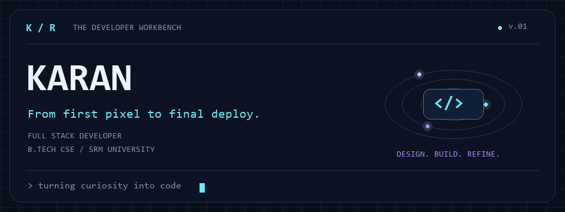
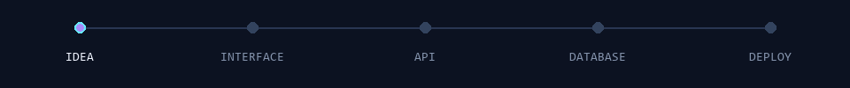

  

<b>Curiosity is the starting point. Building is how I follow it.</b>

---

### ◈ 01 — Behind the keyboard

I like knowing what happens after you click a button. So I build the button, the API behind it, and the database that remembers it.

I'm a Computer Science student at **SRM University**, building web applications from the first rough idea to the final deployment. I enjoy the point where design and logic meet: an interface that feels natural, backed by code that makes sense.

This GitHub is my workbench. Some repositories are experiments, some are lessons, and some are ideas I couldn't leave alone.

> The best part of learning something new? Finally having a use for that idea in your notes.

### ⌁ 02 — Following the request

| Layer | What I care about |
| :--- | :--- |
| **The interface** | Clear layouts, thoughtful interactions, and the small details that make an app feel right. |
| **The logic** | APIs with a purpose, readable code, and understanding how the pieces fit together. |
| **The data** | Giving information a sensible home and making it useful to the application. |
| **The delivery** | Taking an application beyond my editor and getting it running. |

### ⌘ 03 — Tools on the workbench

**Interfaces & interactions**

**Servers & services**

**Data & deployment**

<b>Open the rest of the toolbox ↗</b>

 

| Area | Technologies & tools |
| :--- | :--- |
| Languages | C, C++, C#, Java, PHP, Rust, Elixir, HTML, CSS |
| Web & mobile | React Native, React Query, React Router, React Hook Form, Vite, jQuery |
| Backend | NestJS, Flask, Django REST Framework, .NET, Apache |
| Data | Dgraph, Oracle |
| Machine learning & scientific computing | PyTorch, TensorFlow, scikit-learn, OpenCV, NumPy, Pandas, SciPy, Anaconda, CUDA |
| Data visualization | Matplotlib, Plotly |
| Design & creative tools | Figma, Blender, Photoshop, Premiere Pro, Canva, Adobe tools |
| Development & infrastructure | GitHub, GitLab, NPM, Nodemon, Netlify, PowerShell, Windows Terminal, Cisco |
| Beyond the browser | Raspberry Pi, Unreal Engine |

### ↗ 04 — Footprints in the code

 

 

---

<h3>Every good build starts with a conversation.</h3>

Have an idea, a question, or an interesting problem? Say hello.

<a href="mailto:ravadakaran733@gmail.com">Drop me a message</a> · <a href="https://linkedin.com/in/ravada-karan">Connect on LinkedIn</a>

  

<code>end of README ≠ end of curiosity</code>

